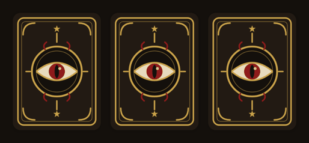
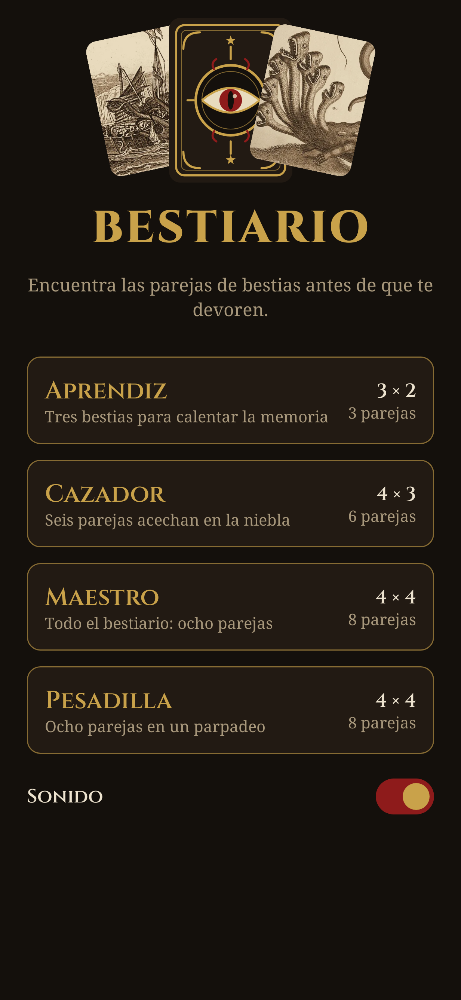
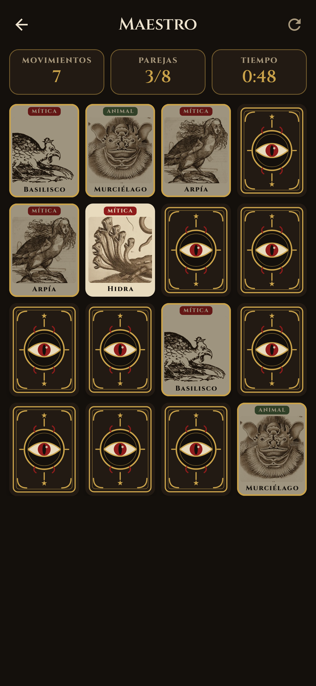
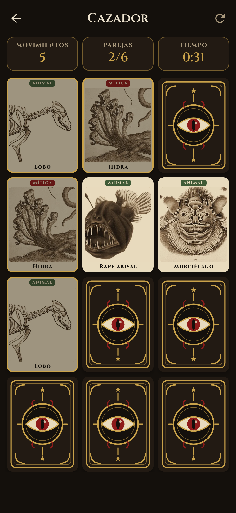
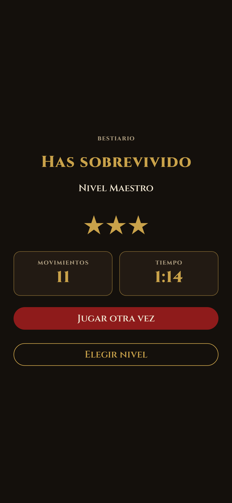
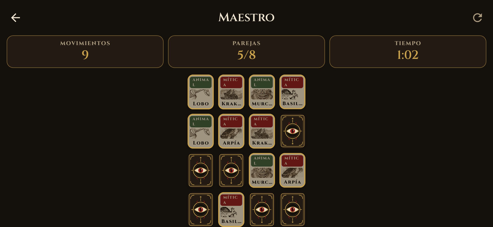
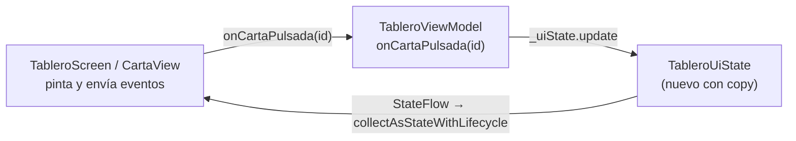

# Memory: Bestiario

## 1. Datos del proyecto

| | |
| :--- | :--- |
| **Autor** | Luis Gordillo |
| **Módulo / curso** | PMDM · 2º DAM · 2026/2027 |
| **Temática** | Criaturas míticas y animales grotescos sacados de grabados antiguos de historia natural |

## 2. Temática y fuente de las imágenes

Bestiario es un juego de memoria con estética de libro antiguo: fondo de tinta, cartas de pergamino y acentos rojo sangre y dorado. Las cartas mezclan criaturas de leyenda (hidra, kraken, arpía, basilisco) con animales reales con aspecto inquietante (el esqueleto de un lobo, un rape abisal, un murciélago y una hiena). Cada carta lleva una insignia **MÍTICA** o **ANIMAL**.

Las ilustraciones son grabados de **dominio público** descargados de Wikimedia Commons. Las he recortado y les he aplicado el mismo tono sepia y un viñeteado (Pillow, en Python) para que todas parezcan del mismo libro. Las versiones descargadas están en `docs/fuentes/` y el diseño de las cartas en Figma (enlace en el apartado 3).

| Imagen (`res/drawable-nodpi`) | Obra original y autoría | Licencia | Fuente |
| :--- | :--- | :--- | :--- |
| `carta_hidra.webp` | Albertus Seba, *Locupletissimi rerum naturalium thesauri*, lámina de la hidra (1734) | Dominio público | [Commons](https://commons.wikimedia.org/wiki/File:Albertus_Seba_-_Hydra.jpg) |
| `carta_arpia.webp` | Ulisse Aldrovandi, *Monstrorum historia* (Bolonia, 1642); grabado de Jean-Baptiste Coriolan | Dominio público | [Commons](https://commons.wikimedia.org/wiki/File:Aldrovandi-0337.jpg) |
| `carta_basilisco.webp` | Grabado anónimo de un basilisco (1640) | Dominio público | [Commons](https://commons.wikimedia.org/wiki/File:Basilisk_(1640).png) |
| `carta_kraken.webp` | Pierre Denys de Montfort, *Le poulpe colossal* (principios del s. XIX) | Dominio público | [Commons](https://commons.wikimedia.org/wiki/File:Denys_de_Montfort_Poulpe_Colossal.jpg) |
| `carta_murcielago.webp` | Ernst Haeckel, *Kunstformen der Natur*, lámina «Chiroptera» (1904) | Dominio público | [Commons](https://commons.wikimedia.org/wiki/File:Haeckel_Chiroptera.jpg) |
| `carta_rape.webp` | Ilustración científica de *Melanocetus johnsonii* (autor no indicado en la ficha) | Dominio público | [Commons](https://commons.wikimedia.org/wiki/File:Humpback_anglerfish.png) |
| `carta_hiena.webp` | Alfred Brehm, *Brehms Tierleben*, hienas rayadas (1894) | Dominio público | [Commons](https://commons.wikimedia.org/wiki/File:Brehms_striped_hyenas.png) |
| `carta_lobo.webp` | Richard Lydekker, esqueletos de *Canis lupus* y *Crocuta crocuta* (1893) | Dominio público | [Commons](https://commons.wikimedia.org/wiki/File:Canis_lupus_%26_Crocuta_crocuta.png) |
| `carta_reverso.xml`, `ic_launcher_foreground.xml` | Hechos por mí como vectores (el ojo del bestiario) | Propia | — |
| `ic_volver.xml`, `ic_reiniciar.xml` | Iconos «arrow_back» y «refresh» de Material Icons (Google) | Apache 2.0 | [Material Icons](https://fonts.google.com/icons) |
| `font/cinzel.ttf` | Fuente Cinzel (The Cinzel Project Authors) | SIL Open Font License 1.1 | [Google Fonts](https://github.com/google/fonts/tree/main/ofl/cinzel) |
| `raw/giro.wav`, `pareja.wav`, `fallo.wav`, `victoria.wav` | Sintetizados por mí con un script en Python | Propia | — |

## 3. Captura o GIF



| Inicio | Tablero | Fallo (bloqueado) | Resultado |
| :---: | :---: | :---: | :---: |
|  |  |  |  |

En horizontal el tablero se reorganiza para caber sin scroll: 

Diseño en Figma (cartas, pantallas y guía de estilo): [fichero de Figma](https://www.figma.com/design/7RvGif7X8R2ZiTxolygqte). Exportaciones en `docs/figma/`.

## 4. Cómo compilar, ejecutar y probar

```bash
./gradlew assembleDebug          # compila la app
./gradlew testDebugUnitTest      # ejecuta los tests unitarios (14 tests: ViewModel, reparto y niveles JSON)
./gradlew crearZip -Pnombre=gordillo-luis   # genera entrega/memory-gordillo-luis.zip
```

Los niveles se leen de `app/src/main/assets/niveles.json`:

| Nivel | Tablero | Parejas | Retardo del fallo |
| :--- | :---: | :---: | :---: |
| Aprendiz | 3 × 2 | 3 | 0,9 s |
| Cazador | 4 × 3 | 6 | 0,9 s |
| Maestro | 4 × 4 | 8 | 0,9 s |
| Pesadilla | 4 × 4 | 8 | 0,45 s |

## 5. Organización y estructura del proyecto

### 5.1. Paquetes

```text
com.pm2627.p1ev.memory
├── MainActivity.kt   ← punto de entrada: tema + MemoryApp
├── model/            ← qué es una carta, una criatura y un nivel; reparto y estrellas (sin nada de pantalla)
├── datos/            ← lectura de los niveles desde assets/niveles.json
├── navegacion/       ← destinos de Navigation 3 y la pila (MemoryApp)
├── efectos/          ← sonidos con SoundPool
└── ui/
    ├── inicio/       ← pantalla de elección de nivel
    ├── tablero/      ← pantalla, ViewModel y UiState de la partida
    ├── resultado/    ← pantalla de resultado
    ├── componentes/  ← CartaView, la carta con su volteo
    └── theme/        ← colores, tipografía (Cinzel) y tema oscuro
```

### 5.2. Ficheros importantes

| Fichero | Qué hace |
| :--- | :--- |
| `model/Carta.kt` | `data class Carta(id, criatura, estado)` y `enum class EstadoCarta` (BOCA_ABAJO, BOCA_ARRIBA, EMPAREJADA). `esParejaDe()` compara la criatura |
| `model/Criatura.kt` | `enum class Criatura` con nombre, tipo (`TipoCriatura`: MITICA / ANIMAL) e imagen (`@DrawableRes`) |
| `model/Nivel.kt` | `@Serializable data class Nivel` con filas, columnas y retardo del fallo; calcula `parejas` y `totalCartas` |
| `model/Reparto.kt` | `repartir(nivel, random)` (take → flatMap → shuffled → mapIndexed) y `calcularEstrellas()` |
| `datos/NivelesRepositorio.kt` | `parsear(texto)` con kotlinx.serialization y `cargar(context)` desde assets, con niveles por defecto si falla |
| `ui/tablero/TableroUiState.kt` | El estado inmutable de la partida: cartas, movimientos, segundos, bloqueado, ganada, última jugada. Parejas encontradas = propiedad calculada |
| `ui/tablero/TableroViewModel.kt` | **La lógica del juego**: `onCartaPulsada(id)`, bloqueo y retardo del fallo, temporizador en un `Job`, `onSalirDeLaApp()` / `onVolverALaApp()`, `onNuevaPartida()` |
| `ui/tablero/TableroScreen.kt` | `TableroScreen` conecta el ViewModel (estado, `LifecycleResumeEffect`, vibración, sonido, navegación al ganar); `TableroContent` solo pinta |
| `ui/componentes/CartaView.kt` | Una carta sin estado propio con el volteo 3D (`animateFloatAsState` + `graphicsLayer`) |
| `ui/inicio/InicioScreen.kt` | Lista los niveles y el interruptor de sonido; avisa con `onNivelElegido(nivel)` |
| `ui/resultado/ResultadoScreen.kt` | Muestra estrellas, movimientos y tiempo que recibe como números |
| `navegacion/Destinos.kt` | `Inicio`, `Tablero(nivelId)` y `Resultado(nivelId, movimientos, segundos)` |
| `navegacion/MemoryApp.kt` | La pila (`rememberNavBackStack`), el `NavDisplay`, los decoradores y qué pasa en cada botón |
| `efectos/Sonidos.kt` | `Sonidos` (SoundPool) y `rememberSonidos()`, que los libera al salir de la pantalla |
| `test/.../ui/tablero/TableroViewModelTest.kt` | 8 tests: emparejar, fallar con bloqueo, ganar, toques ignorados, tiempo, pausa sin doble velocidad, nueva partida |
| `test/.../ui/tablero/MainDispatcherRule.kt` | Cambia `Dispatchers.Main` por un `StandardTestDispatcher` para controlar el reloj virtual |
| `test/.../model/RepartoTest.kt`, `test/.../datos/NivelesRepositorioTest.kt` | Reparto con semilla, estrellas y lectura del JSON |

### 5.3. Cómo fluye un evento

Ejemplo: el jugador toca una carta boca abajo y es la segunda del turno, pero no es pareja.

1. **Pantalla.** En `CartaView.kt` la `Card(onClick = onClick)` recibe el toque. `TableroContent` le pasó `onClick = { onCartaPulsada(carta.id) }`, así que solo envía el id. En `TableroScreen` ese callback suena `sonidos.giro()` y llama a `viewModel.onCartaPulsada(id)`.
2. **ViewModel.** `TableroViewModel.onCartaPulsada(id)` comprueba en orden: no está bloqueado ni ganado, la carta existe y está boca abajo, ya hay una boca arriba (`cartasBocaArriba`), y `primera.esParejaDe(carta)` es falso.
3. **Estado.** Con `_uiState.update { it.copy(cartas = …BOCA_ARRIBA, movimientos = +1, bloqueado = true, ultimaJugada = Jugada(FALLO, n)) }` publica un `TableroUiState` nuevo. Después lanza en `viewModelScope` un `delay(retardoFalloMs)` que vuelve a poner las dos cartas boca abajo y quita el bloqueo.
4. **Pantalla otra vez.** `TableroScreen` recoge el estado con `collectAsStateWithLifecycle()`. `CartaView` ve la carta boca arriba y `animateFloatAsState` la gira. El `LaunchedEffect(estado.ultimaJugada)` lanza la vibración `Reject` y el sonido de fallo. Al acabar el retardo llega otro estado y las cartas se giran solas.



### 5.4. Decisiones de diseño

- **El estado de cada carta está en `TableroUiState.cartas`** (fuente única de verdad, apuntes 3C.1 §2), nunca en `remember` ni en la animación. La animación solo calcula el ángulo a partir de `carta.bocaAbajo` (3A.4: una animación no guarda nada).
- **Pareja = misma `Criatura`.** El `id` es solo la posición (y la `key` de la cuadrícula).
- **Las parejas encontradas no se guardan**: `parejasEncontradas` se calcula de las cartas, así no se puede desincronizar.
- **El temporizador es un `Job` (`jobCronometro`, 3C.1 §5.1).** `arrancarCronometro()` cancela el anterior antes de lanzar otro: volver a la app dos veces no cuenta el doble. Empieza con la primera carta y se cancela al ganar.
- **El bloqueo vive en el estado (`bloqueado`, 3C.1 §5.2)** y se activa en el mismo cambio que gira la segunda carta, antes de esperar. `onCartaPulsada` lo comprueba lo primero.
- **La pausa usa `LifecycleResumeEffect` en `TableroScreen` (3C.1 §5.3)**: `onVolverALaApp()` al llegar a RESUMED y `onPauseOrDispose { onSalirDeLaApp() }` al salir.
- **Azar y retardo por constructor** (`TableroViewModel(nivel, random, retardoFalloMs)`): en los tests uso `Random(42)` y controlo el tiempo virtual con `advanceTimeBy` (3C.1 §5.4, 3C.4 §4).
- **Los destinos llevan datos simples (3B.1 §3)**: `Tablero` solo el `nivelId` y `Resultado` el `nivelId` y dos números. El nivel completo se busca en la lista leída del JSON.
- **Un ViewModel por partida** con `rememberViewModelStoreNavEntryDecorator` (3B.1 §8). Al ganar quito `Tablero` de la pila y añado `Resultado`, así «atrás» desde el resultado vuelve a Inicio y no a un tablero terminado. «Jugar otra vez» crea una entrada nueva y por tanto un ViewModel nuevo.
- **Navegación al ganar una sola vez** con `LaunchedEffect(estado.ganada)`, esperando un poco para que se vea la última pareja.
- **Tablero en horizontal**: `BoxWithConstraints` decide las columnas (las del lado largo) y limita el ancho para que las cartas 3:4 quepan en el alto.
- **Tema oscuro fijo y sin color dinámico**, para que Android 12+ no cambie la paleta del bestiario.

## 6. Mejoras opcionales

| Mejora | API que usa | Fichero y función | Documentación seguida |
| :--- | :--- | :--- | :--- |
| Vibración al acertar, fallar y ganar (+0,5) | `LocalHapticFeedback`, `HapticFeedbackType.Confirm` / `Reject` / `LongPress` | `TableroScreen.kt` · `LaunchedEffect(estado.ultimaJugada)` en `TableroScreen` | [Haptics en Android](https://developer.android.com/develop/ui/views/haptics) |
| Sonidos con SoundPool (+1) | `SoundPool.Builder`, `AudioAttributes`, `load()`, `play()`, `release()` | `efectos/Sonidos.kt` · clase `Sonidos` y `rememberSonidos()`; se usan en `TableroScreen` | [SoundPool](https://developer.android.com/reference/android/media/SoundPool) |
| Niveles en JSON con kotlinx.serialization (+1) | `@Serializable`, `Json { ignoreUnknownKeys = true }`, `decodeFromString` | `datos/NivelesRepositorio.kt` · `parsear()` y `cargar()`; `model/Nivel.kt`; `assets/niveles.json` | [kotlinx.serialization](https://kotlinlang.org/docs/serialization.html) |

Detalles de cada mejora:

- **Vibración:** el ViewModel no sabe nada de vibraciones; solo guarda `ultimaJugada = Jugada(tipo, movimiento)`. Llevar el número de movimiento hace que dos fallos seguidos sean valores distintos y el `LaunchedEffect` se lance las dos veces.
- **Sonidos:** cuatro WAV cortos en `res/raw` (giro de pergamino, campana de pareja, gruñido de fallo y arpegio de victoria). Se pueden desactivar con el interruptor de Inicio (`sonidoActivado`, guardado con `rememberSaveable` en `MemoryApp`).
- **JSON:** el campo `retardoFalloMs` es opcional (por defecto 900 ms). Así el nivel Pesadilla esconde las cartas el doble de rápido sin tocar código. Si el JSON falta o está mal, `cargar()` devuelve `nivelesPorDefecto`. `parsear()` está separada para probarla en la JVM (`NivelesRepositorioTest`).

Otros detalles propios: valoración de 1 a 3 estrellas (`calcularEstrellas`), botón de reiniciar partida, interruptor de sonido, tema y tipografía propios, icono propio y tablero adaptado a horizontal.

## 7. Limitaciones conocidas

- Solo hay 8 criaturas, así que el tablero más grande es 4 × 4. Para un 5 × 4 haría falta añadir dos grabados más a `Criatura`.
- Si Android cierra el proceso de la app (no un simple giro), la partida en curso se pierde: el ViewModel no guarda su estado en `SavedStateHandle`.
- La opción de sonido no se guarda al cerrar la app (no uso DataStore).
- Tampoco se guardan récords por nivel.
- La vibración depende del dispositivo: en algunos móviles `Confirm` y `Reject` se notan igual.
